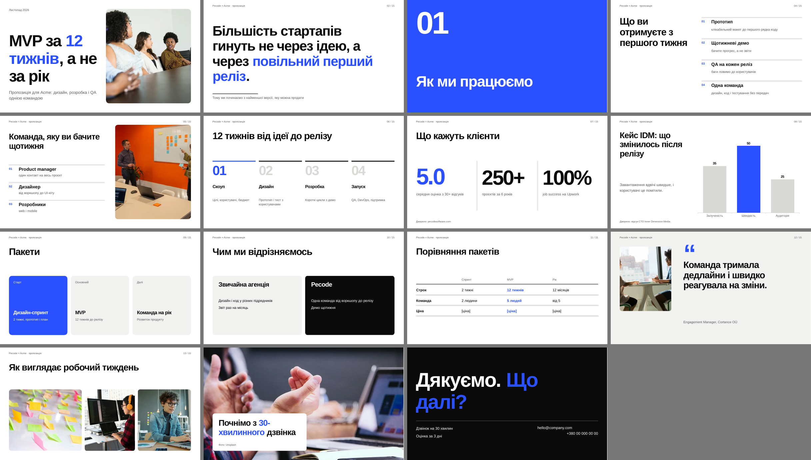
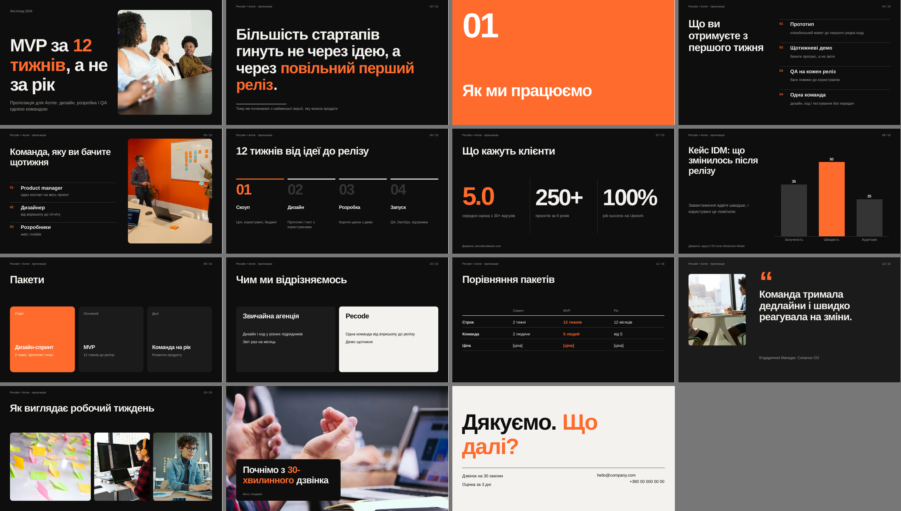

# Presentation Builder

Скіл для Claude, який робить презентації PowerPoint (.pptx) рівня дизайн-студії на будь-яку тему: для HR, продажів чи іншої команди.

- Одне коло питань: контент, стиль, мета, фото.
- Бере готовий текст чи файл або пише сам. Цифри з джерелами, внутрішні дані не вигадує, ставить плейсхолдери `[...]`.
- 5 стилів: Swiss, Studio, Color block, Human, Editorial.
- 14 макетів: обкладинка, розділ, велика думка, пункти, картки, порівняння, цифри, графік, процес, таблиця, цитата, галерея, фото на весь слайд, фінал.
- Фото з Unsplash з перевіркою ліцензії або свої.
- Файл редагується в PowerPoint, Keynote і Google Slides; нотатки доповідача на кожному слайді.

## Встановлення

Завантаж `SKILL.md` як скіл у Claude (Settings → Capabilities → Skills) або поклади папку в `~/.claude/skills/presentation-builder/`.

## Як виглядає

`examples/deck.json` це тестовий пітч, `examples/preview-*.png` його мініатюри у двох стилях.

